<div align="center">

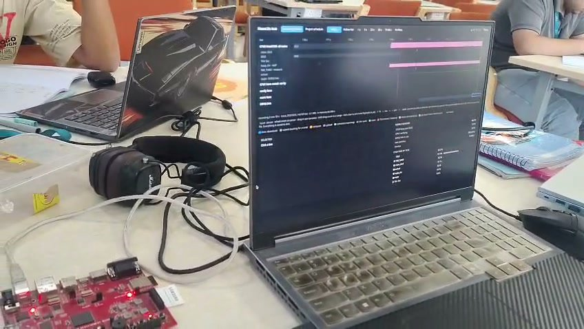

<br/>

# NovaLife HUB

**A medical image that keeps its identity after it leaves the hospital system.**

The hub hides a short, authenticated, revocable pointer inside the pixels of a scan. A copy that was
forwarded on WhatsApp, re-saved as JPEG, resized or cropped can still be traced back to its record,
and a swapped or edited image is caught.

[](#-hardware)
[](#-how-it-works)
[](#-how-it-works)
[](#-product-tour)

**[Product tour](#-product-tour)** · **[Demo videos](#-demo-videos)** · **[Measured results](#-measured-not-promised)** · **[How it works](#-how-it-works)** · **[Quick start](#-quick-start)** · **[Limitations](#%EF%B8%8F-limitations)**

<br/>

<a href="#-product-tour">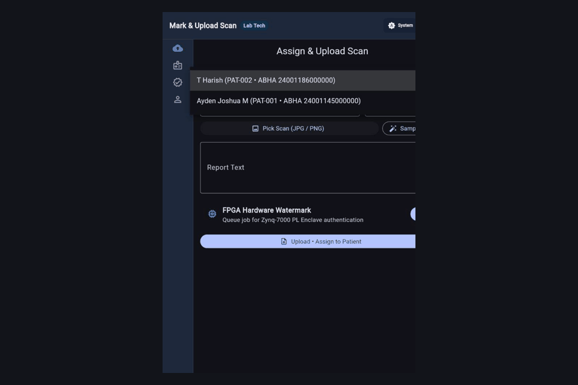</a>

<sub>The three roles in the app: the lab technician assigns a scan, the doctor verifies a copy, the patient sees their own records.</sub>

</div>

---

## The problem

A DICOM header ties an image to a patient. Once the image is exported as a JPEG, screenshotted or
forwarded over a chat app, which is how many scans really travel between doctors, that header is gone.
Nobody can tell which patient a copy belongs to, and a swapped image goes unnoticed. India's Digital
Personal Data Protection Act 2023 also asks that any lookup of personal data be lawful, consented to
and auditable.

## ✨ Why NovaLife

| What it does | What that means |
|---|---|
| **Survives real channels** | Exact 128-bit recovery after JPEG down to quality 40, 0.5x–2x resize and a 25% crop (50/50 marks each, software). |
| **Key stays in hardware** | The Ascon-AEAD128 tag engine and its write-only key sit in the Zynq programmable logic. |
| **No identity in the pixels** | The image carries only a random 64-bit handle and a 48-bit tag. The record stays in the database; revoke the handle and every copy stops resolving. |
| **Works from any network** | The board has no inbound port: an ESP32 opens an outbound TLS link to a cloud job queue. |
| **Two cores, doctor first** | CPU0 runs FreeRTOS and marks images; CPU1 verifies in parallel. A doctor's verify finishes in 4.7 s even while a lab mark is running. |
| **You can watch it schedule** | A live Gantt chart reads the board's trace rings over JTAG without halting a CPU. |

## 📸 Product tour

Captured from the web build of the app on **30 October 2026**, signed in as each team member. The
records shown are sample entries made for the demonstration; the board numbers are in
[Measured, not promised](#-measured-not-promised).

<table>
<tr>
<td width="50%" valign="top">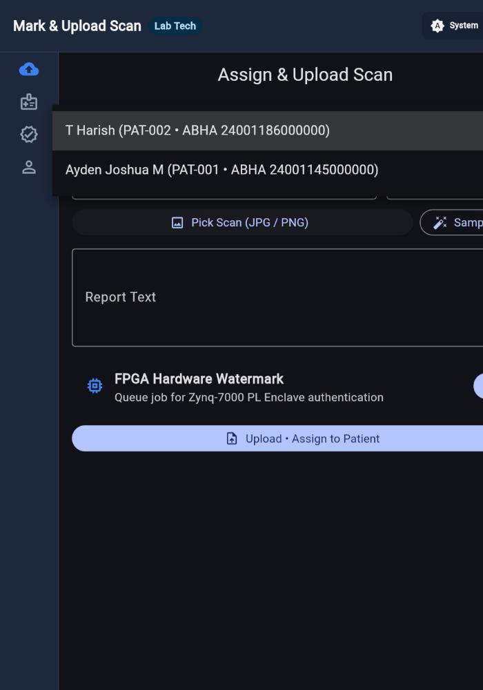<br/><b>01 / Lab technician</b><br/><sub>Assigns an uploaded scan and its report to a patient; the board marks it.</sub></td>
<td width="50%" valign="top">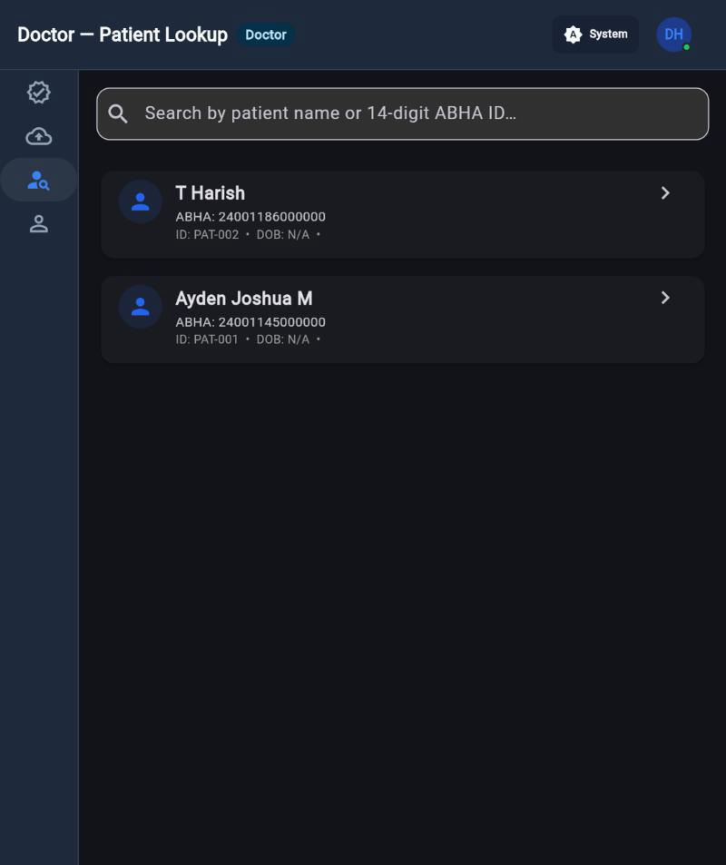<br/><b>02 / Doctor lookup</b><br/><sub>Finds a patient by name or ABHA number.</sub></td>
</tr>
<tr>
<td valign="top">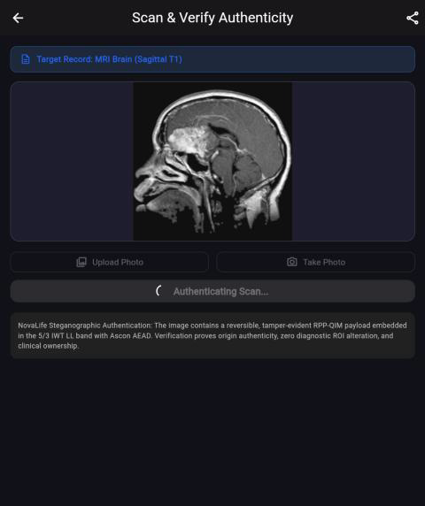<br/><b>03 / Scan and verify</b><br/><sub>A received copy goes to the cloud queue; the board picks it up.</sub></td>
<td valign="top">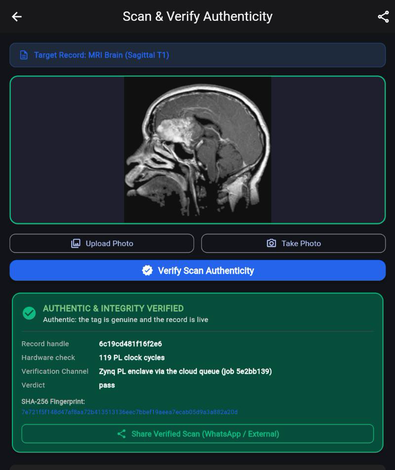<br/><b>04 / Verdict</b><br/><sub>Pass, fail or revoked, with the record handle.</sub></td>
</tr>
<tr>
<td valign="top">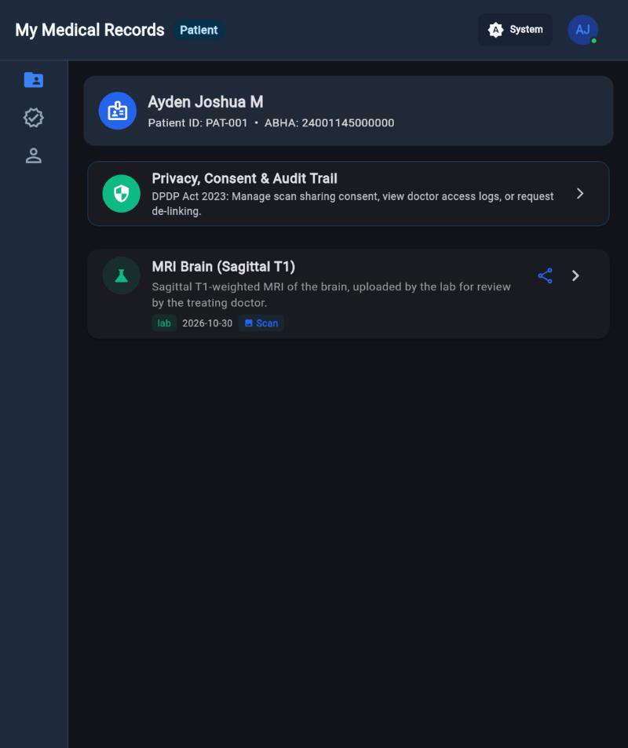<br/><b>05 / Patient records</b><br/><sub>A patient sees only their own records (row-level security).</sub></td>
<td valign="top">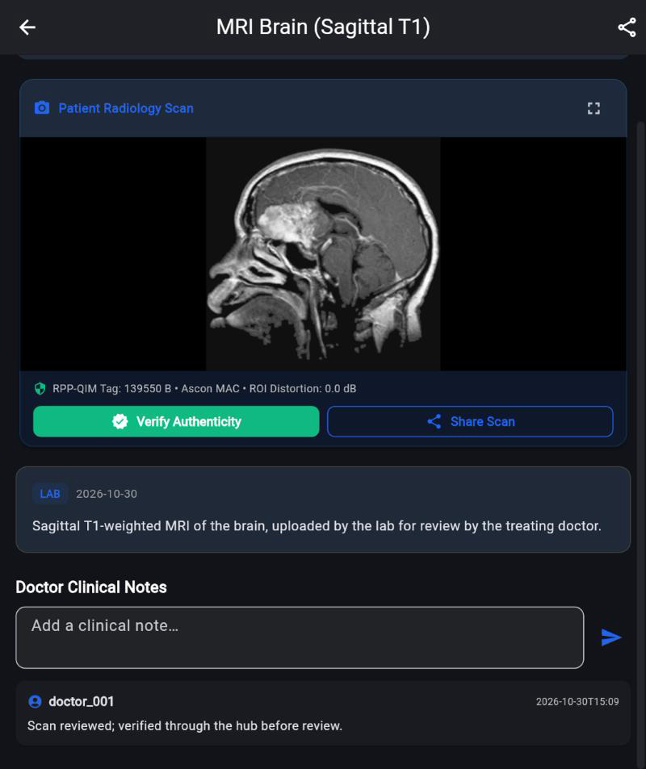<br/><b>06 / Report and note</b><br/><sub>The lab report with the doctor's note.</sub></td>
</tr>
</table>

<div align="center">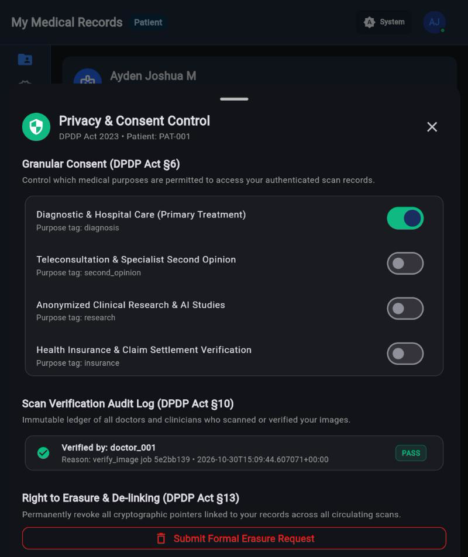<br/><b>07 / Consent and audit</b><br/><sub>Consent per purpose and a hash-chained verification log.</sub></div>

## 🎬 Demo videos

Recorded on 30 October 2026 with the board booting from the SD card (muted, captioned).

| | |
|---|---|
| 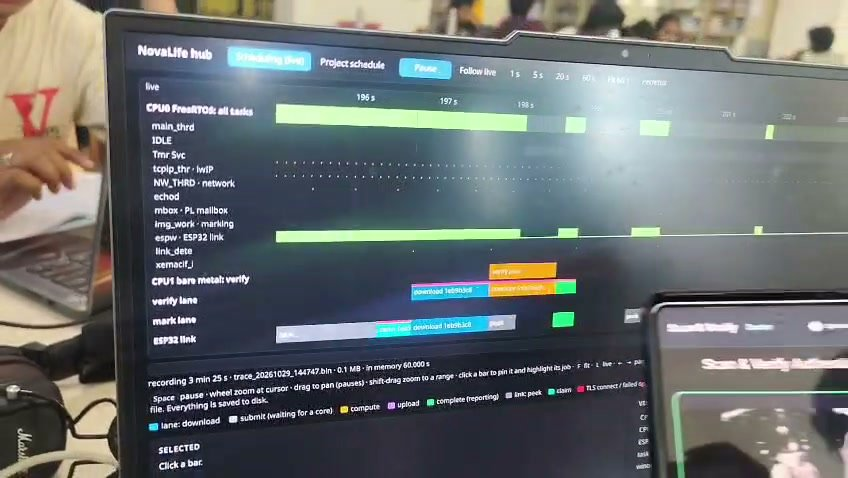 | 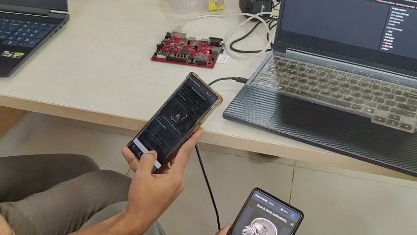 |
| 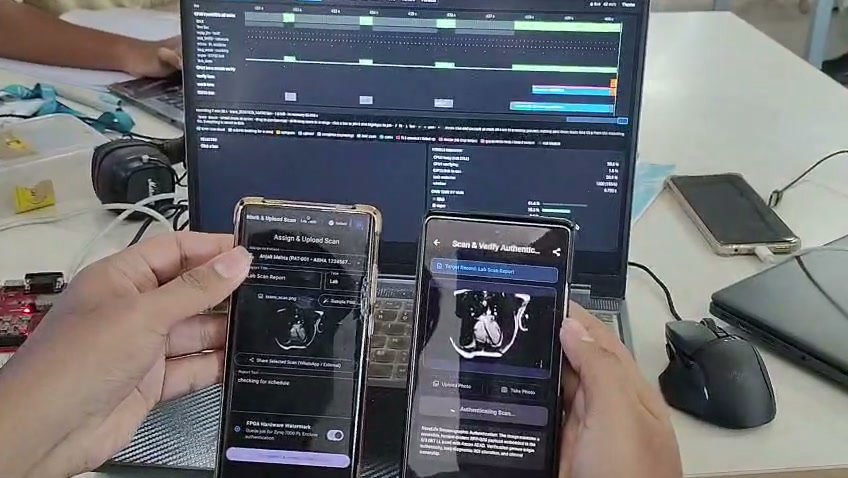 | 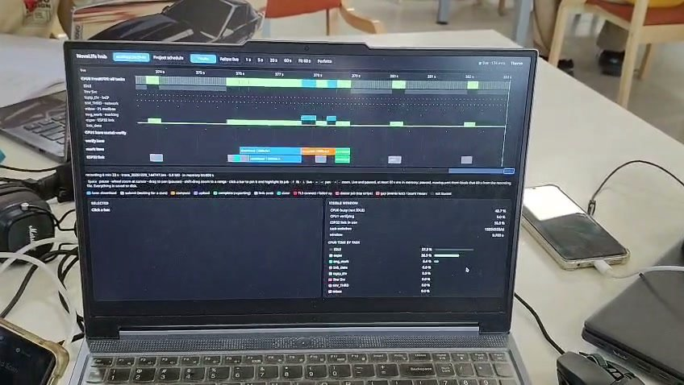 |

| Video | Google Drive | GitHub |
|---|---|---|
| Full demonstration (2 min 22 s) | [watch on Drive](https://drive.google.com/file/d/1jhVtCmx0EyrmbRRv5w4-0f1exJS7DjEz/view) | [novalife_demo.mp4](novalife/demo/novalife_demo.mp4) |
| 1 · System overview | [watch on Drive](https://drive.google.com/file/d/1oaS_5USzWM7oD8XnNKtYpwHTLM7f5wWF/view) | [01_overview.mp4](novalife/demo/01_overview.mp4) |
| 2 · Lab upload, board marks, phones verify | [watch on Drive](https://drive.google.com/file/d/14TTA3MRbPzu4H6hit-9BdKlQV-oTS0CO/view) | [02_upload_and_verify.mp4](novalife/demo/02_upload_and_verify.mp4) |
| 3 · Several users at once | [watch on Drive](https://drive.google.com/file/d/1BGe1sii5iORvVIk6Ji8R1GZvXBFZk2I5/view) | [03_multiple_users.mp4](novalife/demo/03_multiple_users.mp4) |
| 4 · Verify on the Gantt | [watch on Drive](https://drive.google.com/file/d/1s9Y8JGQUXOk8oCOZ9fZwzNLDiZ8Fc9r_/view) | [04_verify_on_gantt.mp4](novalife/demo/04_verify_on_gantt.mp4) |

All five in one place: [Google Drive folder](https://drive.google.com/drive/folders/1xnlXubycjRi23QyQ4ZOHQ-t9Mo_6dWoC).

## 📊 Measured, not promised

Every number below comes from a file in [`novalife/hub/results/`](novalife/hub/results/), and each row
says where it was measured.

### Robustness of the mark (software, 5 covers × 10 handles = 50 marks per condition)

| Condition | Tag accepted | Exact 128 bits |
|---|---:|---:|
| No attack | 50/50 | 50/50 |
| JPEG quality 90 / 70 / 50 / 40 | 50/50 each | 50/50 each |
| Resize 0.5x / 0.75x / 1.5x / 2.0x | 50/50 each | 50/50 each |
| Screenshot-like: 0.75x then JPEG 80 | 50/50 | 50/50 |
| Crop 25% off top and left | 50/50 | 50/50 |
| Gaussian noise, sigma 2 | 50/50 | 50/50 |
| Wrong key (false accept) | **0/50** | – |

Source: [`tag_matrix_2026-10-22.md`](novalife/hub/results/tag_matrix_2026-10-22.md). On real data,
10 of 10 Kaggle brain MRI slices (512×512) returned their exact payload, and the C code that runs on
the board matched the Python reference on 47/47 vectors bit for bit
([`e2e_2026-10-22.md`](novalife/hub/results/e2e_2026-10-22.md),
[`c_port_2026-10-22.md`](novalife/hub/results/c_port_2026-10-22.md)).

### On the board

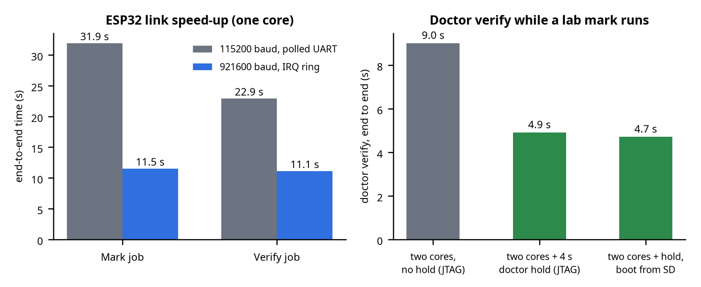

| Measurement | Before | After |
|---|---|---|
| Mark job, end to end | 31.9 s at 115200 baud | **11.5 s** at 921600 baud |
| Verify job, end to end | 22.9 s | **11.1 s** |
| Doctor verify during a lab mark | 9.0 s (two cores, no hold) | **4.7 s** booted from SD |
| Priority 99 requested by a client | – | stored as 0 (database trigger) |
| Handle generator, 200,000 handles | fixed-seed PRNG | no duplicate |
| UART errors after the runs | – | 0 overruns, 0 ring drops |

Source: [`two_core_scheduling_2026-10-29.md`](novalife/hub/results/two_core_scheduling_2026-10-29.md).

### Programmable logic (XC7Z010, 100 MHz)

| Design | Resources | Timing |
|---|---|---|
| Enclave: tag engine + AXI mailbox (post-route) | 1987 LUT, 1839 FF, 0 BRAM, 0 DSP | WNS +1.973 ns, 119 cycles per tag |
| Block embed core (post-synthesis) | 450 LUT, 490 FF | WNS +1.411 ns, 123/123 vectors bit-exact |

Source: [`g2_ascon_sp800_2026-10-20.md`](novalife/hub/results/g2_ascon_sp800_2026-10-20.md),
[`g2_block_embed_2026-10-20.md`](novalife/hub/results/g2_block_embed_2026-10-20.md).

### Scheduling seen on the running board

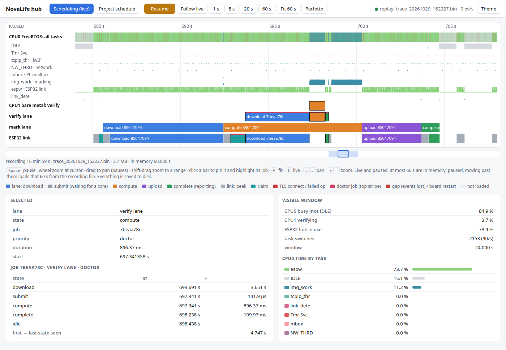

The lab mark computes on CPU0 while the doctor's verify downloads, computes for 0.896 s on CPU1 and
completes, 4.747 s from claim to idle. Recording only real task switches (90–193 per second) shrank
207 s of trace from 135 MB to 0.79 MB.

## 🧠 How it works

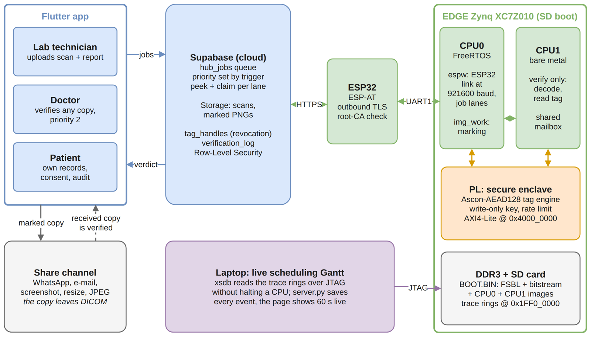

The app never embeds or reads the mark. It stores the image in Supabase Storage and adds a job to
the `hub_jobs` queue; a trigger sets the job's priority from the user's role. The board peeks at the
queue over the ESP32, claims a job for a free lane and runs it: marking on CPU0, verification on CPU1.

<table>
<tr>
<td width="50%" valign="top">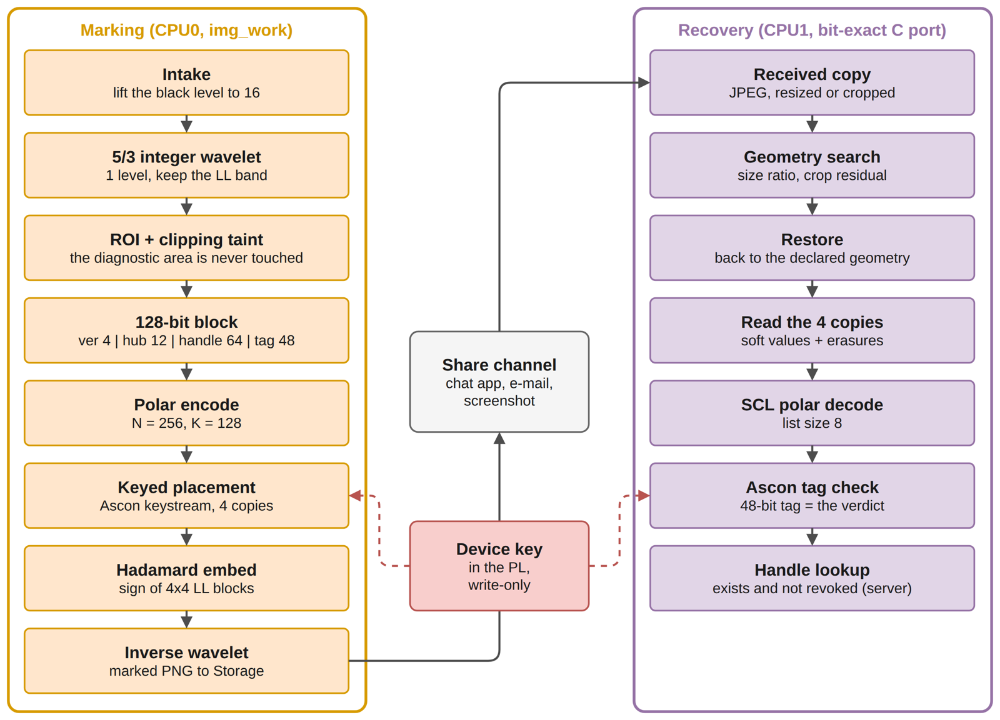<br/><b>Marking and recovery</b><br/><sub>5/3 integer wavelet, ROI kept untouched, polar code (N = 256, K = 128), keyed placement, sign-of-Hadamard embed; recovery searches the geometry, decodes with list size 8 and checks the 48-bit tag.</sub></td>
<td width="50%" valign="top">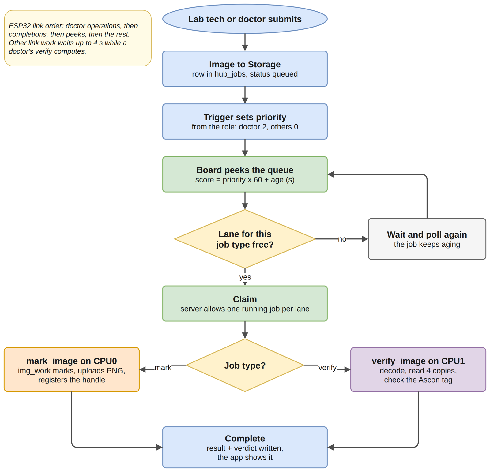<br/><b>One job, end to end</b><br/><sub>score = 60 × priority + age, one running job per lane, doctor operations first on the shared ESP32 link.</sub></td>
</tr>
</table>

The diagrams are draw.io files in [`novalife/docs/diagrams/`](novalife/docs/diagrams/). Open them at
[app.diagrams.net](https://app.diagrams.net) to edit.

| Part | Where |
|---|---|
| Algorithm specification | [`novalife/hub/docs/algorithm.md`](novalife/hub/docs/algorithm.md) |
| Python reference (the oracle) | [`novalife/hub/tools/tag_reference/`](novalife/hub/tools/tag_reference/) |
| C port used on the board | [`novalife/hub/hubcore/`](novalife/hub/hubcore/) |
| FreeRTOS firmware (CPU0) and CPU1 worker | [`novalife/hub/firmware/`](novalife/hub/firmware/) |
| PL cores (Verilog) | [`novalife/hub/vivado/ip_repo/`](novalife/hub/vivado/ip_repo/) |
| Live Gantt viewer | [`novalife/trace_viewer/`](novalife/trace_viewer/) |
| Database migrations | [`novalife/supabase/migrations/`](novalife/supabase/migrations/) |
| Flutter app | [`novalife/app/`](novalife/app/) |

## 🚀 Quick start

**App**

```bash
cd novalife/app
cp .env.example .env        # fill in SUPABASE_URL and SUPABASE_ANON_KEY (never commit .env)
flutter pub get
flutter run
```

**Database:** apply [`novalife/supabase/migrations/`](novalife/supabase/migrations/) in order (001–016).

**Firmware:** copy `novalife/hub/firmware/src/config_local.example.h` to `config_local.h` (gitignored),
fill in the Wi-Fi and device settings, build the CPU0 app in Vitis and the CPU1 worker with
`core1/Makefile`, and pack `BOOT.BIN` from `novalife/hub/firmware/boot/boot.bif`. `BOOT.BIN` and the
ELF files embed those settings and are never committed.

**Enclave bitstream**

```bash
cd novalife/hub
NOVALIFE_OUT=$PWD/vivado/NovaLife_Hub vivado -mode batch -source vivado/scripts/build_enclave.tcl
```

**Live Gantt** (board on JTAG, or a saved recording)

```bash
python3 novalife/trace_viewer/server.py
python3 novalife/trace_viewer/server.py --replay novalife/trace_viewer/recordings/<file>.bin
```

## 🔬 Reproducing the results

```bash
cd novalife/hub/tools/tag_reference
python run_matrix.py --covers 5 --seeds 10     # robustness table
cd ../../hubcore && make test                  # C port against the Python reference
cd ../vivado && ./scripts/run_sim.sh <core>    # bit-exact simulation of a PL core
```

## 🔧 Hardware

| | |
|---|---|
| Board | EDGE Zynq SoC kit, XC7Z010-1CLG400, dual Cortex-A9, DDR3 |
| Network | on-board ESP32 (ESP-AT), UART1 at 921600 baud, outbound TLS only |
| Boot | SD card: FSBL + bitstream + CPU0 + CPU1 images |
| Debug | Digilent USB-JTAG; the Gantt reads memory with `xsdb mrd -force` |

ESP32 flashing notes: [`novalife/hub/tools/esp_flash/`](novalife/hub/tools/esp_flash/).

## 🧭 Roadmap

- Move the marking pipeline from CPU0 into the programmable logic, so the key never leaves the PL.
- Measure real WhatsApp and Telegram round trips (the channels are simulated so far).
- Recover a symmetric crop of 10% or more.
- Compile CPU0 with optimisation (it runs at -O0 today).

## ⚠️ Limitations

- A **symmetric crop of 10% or more** is not recovered.
- **No real chat-app send** has been measured yet; chat-app damage is modelled.
- **Marking runs on the PS** (CPU0), so the key is also held there for now; only the tag engine is in the PL.
- The **SD boot** failed the FSBL's DDR check on some power-ups; power supply suspected, not measured.
- Every technique used is published. The contribution is a measured system, not a new algorithm.

## 👥 Team

<table>
<tr>
<td align="center"><a href="https://github.com/haripriyanr"><br/><b>Haripriyan R</b></a><br/><sub>24BEC1080 · FPGA, firmware, app</sub></td>
<td align="center"><a href="https://github.com/Sudharsan210"><br/><b>Sudharsan G S</b></a><br/><sub>25BEC1182</sub></td>
<td align="center"><a href="https://github.com/Aydenj-osh"><br/><b>Ayden Joshua M</b></a><br/><sub>24BEC1145</sub></td>
<td align="center"><a href="https://github.com/ha721ish"><br/><b>T Harish</b></a><br/><sub>24BEC1186</sub></td>
</tr>
</table>

BECE403E Embedded Systems Design, School of Electronics Engineering, VIT Chennai · Guide: Prof. Muthulakshmi S

<div align="center"><sub>NovaLife HUB · Zynq XC7Z010 · FreeRTOS · Ascon-AEAD128 · polar SCL · Flutter · Supabase</sub></div>
